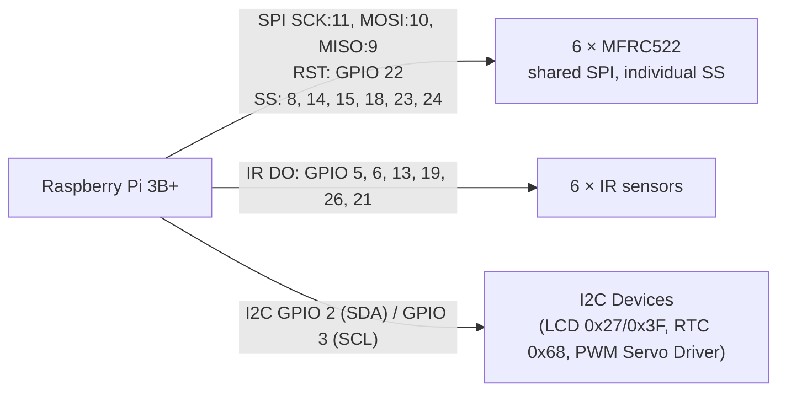

# SmartPark Raspberry Pi 3B+ Wiring Diagram

This is the wiring configuration used by `raspberry_pi_controller.py`. Keypad and LEDs have been removed, and the I2C bus is shared by the LCD, RTC, and PWM Servo Motor Driver. GPIO numbers are BCM numbers.

## RFID readers

All six MFRC522 readers share these common SPI connections:
- `SCK` → GPIO 11 (Physical Pin 23)
- `MOSI` → GPIO 10 (Physical Pin 19)
- `MISO` → GPIO 9 (Physical Pin 21)
- `RST` → GPIO 22 (Physical Pin 15)
- `VCC` → regulated 3.3 V
- `GND` → common ground

| Slot | Reader `SDA` / `SS` GPIO | Physical Pin |
|---|---:|---:|
| P-01 | GPIO 8 | Pin 24 |
| P-02 | GPIO 14 | Pin 8 |
| P-03 | GPIO 15 | Pin 10 |
| P-04 | GPIO 18 | Pin 12 |
| P-05 | GPIO 23 | Pin 16 |
| P-06 | GPIO 24 | Pin 18 |

## IR sensors

Each IR sensor uses `VCC` → regulated 3.3 V and `GND` → common ground.

| Slot | Sensor `DO` GPIO | Physical Pin |
|---|---:|---:|
| P-01 | GPIO 5 | Pin 29 |
| P-02 | GPIO 6 | Pin 31 |
| P-03 | GPIO 13 | Pin 33 |
| P-04 | GPIO 19 | Pin 35 |
| P-05 | GPIO 26 | Pin 37 |
| P-06 | GPIO 21 | Pin 40 |

## Shared I2C — LCD, DS3231 RTC, and PWM Servo Motor Driver

All I2C peripherals connect to the shared Raspberry Pi I2C bus:

| Raspberry Pi connection | Connect to |
|---|---|
| GPIO 2 / SDA (Physical Pin 3) | LCD SDA, DS3231 SDA, and PWM Servo Driver SDA |
| GPIO 3 / SCL (Physical Pin 5) | LCD SCL, DS3231 SCL, and PWM Servo Driver SCL |
| Regulated 3.3 V / Power | VCC / Logic power (when supported) |
| Common ground | GND / Common Ground |

- DS3231 RTC default address: `0x68`
- 16x2 LCD default address: `0x27` or `0x3F`
- PWM Servo Motor Driver (PCA9685) default address: `0x40`

> **Note**: If any 5 V I2C device is connected to the Pi, use a bidirectional level shifter to protect GPIO 2 and GPIO 3.

## Safety and setup

- Use a separate regulated 3.3 V power rail for the six MFRC522 readers and six IR modules. Join its ground to Pi ground.
- Enable SPI and I2C interfaces in `raspi-config`.

